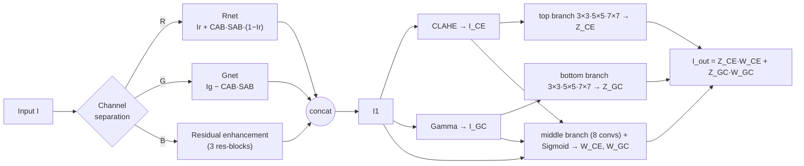
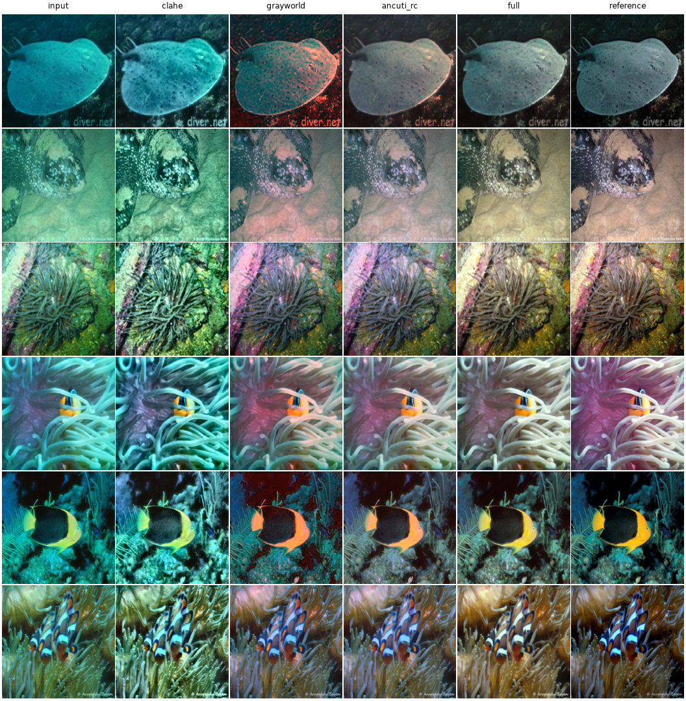
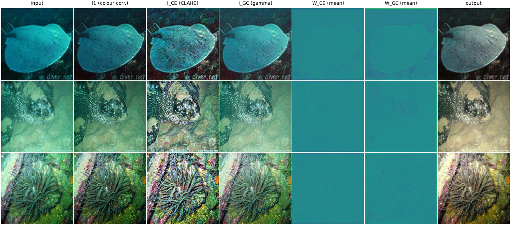
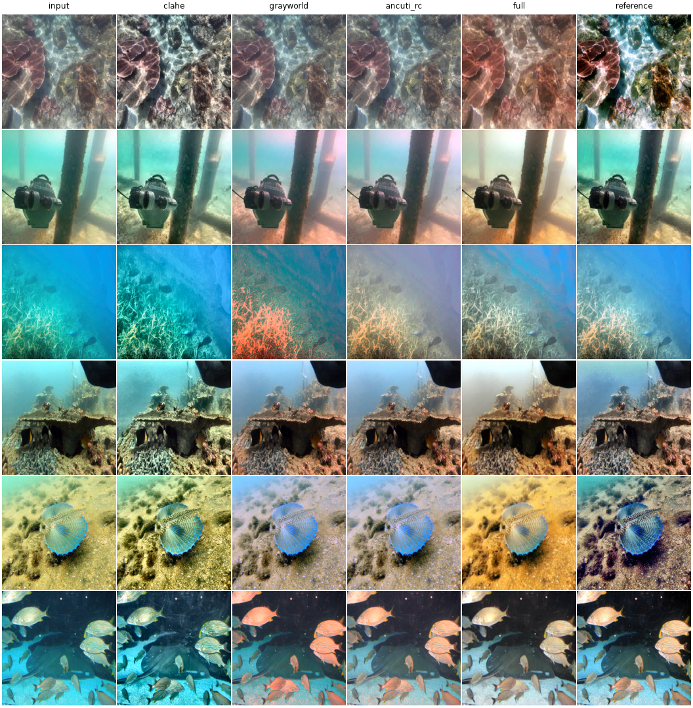
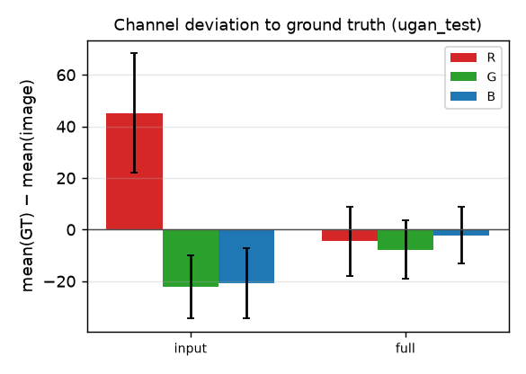
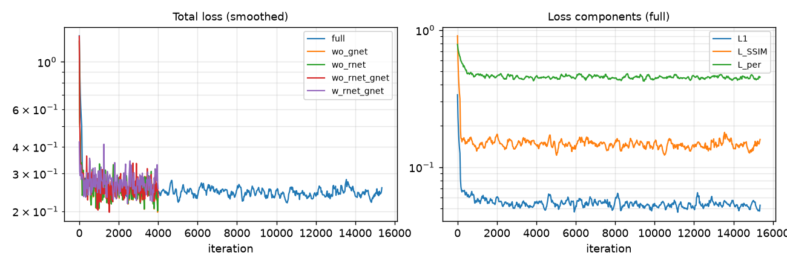

# UIENetHybrid — Underwater Image Enhancement with Deep Learning + Traditional Techniques

[](https://github.com/akashch1013/UIENetHybrid/actions/workflows/docs.yml)
**Documentation:** <https://akashch1013.github.io/UIENetHybrid/>

A PyTorch implementation of

> Z. Shi, Y. Wang, Z. Zhou, W. Ren, **"Integrating deep learning and traditional image enhancement techniques for underwater image enhancement"**, *IET Image Processing* 16 (13): 3471–3484, 2022. doi:[10.1049/ipr2.12544](https://doi.org/10.1049/ipr2.12544) — paper in [`Resources/Group 6.pdf`](Resources/Group%206.pdf).

The network corrects colour **per channel** (red is boosted, green is reduced, blue is refined) using attention-guided residual modules. It then improves contrast and sharpness with a multi-scale CNN that fuses **CLAHE** and **Gamma correction** results using learned confidence maps.

> **Headline (UGAN test-100, the paper's main benchmark):** PSNR-RGB **16.77 → 23.63 dB** and SSIM **0.854 → 0.884**. The paper reports 25.67 dB / 0.891. Ours trained for 30.7 epochs (25 min on one L40S) instead of 50. The red/green colour bias of Fig. 1 is removed (Fig. 11 reproduced). The full report is [`report/CA4_Result_Analysis_Report.pdf`](report/CA4_Result_Analysis_Report.pdf) ([.docx](report/CA4_Result_Analysis_Report.docx)).

---

## 1. Method



### 1.1 Motivating prior (paper Fig. 1)
For each image, the paper measures the mean of each channel in the ground truth minus its mean in the raw underwater image. **Red** comes out consistently positive, meaning it is attenuated. **Green** comes out negative, meaning it is over-strengthened. **Blue** stays near zero. `analyze_channels.py` reproduces this analysis; see [Results](#4-results).

### 1.2 Attention-guided colour compensation (paper §3.1, Fig. 3)

| Module | Equation | What it does |
|---|---|---|
| **Rnet** | `Irc = Ir + CAB(Ir) · SAB · (1 − Ir)`  (Eq. 1) | Adds red. The `(1 − Ir)` factor (from Ancuti et al.) keeps already-bright pixels from being over-compensated. |
| **Gnet** | `Iga = Ig − CAB(Ig) · SAB`  (Eq. 2) | Subtracts part of the over-strong green. |
| **Bnet** | `Ib + Res(Ib)` | Residual brightness enhancement (conv-LReLU-conv-LReLU-conv blocks). |

- **CAB** is channel attention, *Global Average Pooling → FC → Sigmoid* (squeeze-and-excitation).
- **SAB** is spatial attention, *3×3 conv → 3×3 conv → Sigmoid*, which gives an H×W×1 map.
- Each module ends with a long skip connection from its input channel.

### 1.3 Contrast enhancement: MSCNN + CLAHE + Gamma (paper §3.2, Fig. 4)
- `I_CE = CLAHE(I1)` and `I_GC = I1^γ`.
- **Top and bottom branches** (3×3 → 5×5 → 7×7 convs) refine `I_CE` and `I_GC` into `Z_CE` and `Z_GC`, removing the casts and artefacts that CLAHE and Gamma introduce.
- **Middle branch** takes `[I1, I_CE, I_GC]` through 3×3, 5×5, 7×7, 1×1, 3×3, 5×5 and 7×7 convs, then a 3×3 conv to 6 maps and a Sigmoid. The output is split in half to give `W_CE` and `W_GC`.
- **Output** (Eq. 3): `I_out = Z_CE · W_CE + Z_GC · W_GC`.

### 1.4 Loss (paper §3.3, Eq. 8)
`L = λ1 (L1 + L_SSIM) + λ2 · L_per`, with λ1 = 1 and λ2 = 0.1 (the best setting in Table 5).
- `L_SSIM` is computed on grayscale images with an 11×11 Gaussian window.
- `L_per` is the L1 distance between VGG-19 *relu4_3* features of the prediction and of the ground truth.

### 1.5 Implementation choices where the paper is not explicit
| Detail | Choice | Reason |
|---|---|---|
| CAB on a 1-channel input | Lift the channel to 32 features with a 3×3 conv, apply CAB to those features, then map back with a 3×3 conv | GAP→FC over a single channel has nothing to weigh |
| Placement of `(1 − Ir)` | Multiplies the *whole* compensation term | Matches Eq. 1 literally; a saturated red channel (`Ir = 1`) is left unchanged, and the smoke test checks this |
| CLAHE | `kornia.enhance.equalize_clahe`, clip 2.0, 8×8 tiles, per RGB channel, no gradient | Behaves like OpenCV CLAHE |
| Gamma | γ = 0.7 | Same value Water-Net uses (Li et al., the UIEB paper) |
| SSIM constants | "c1 = 0.02, c2 = 0.03" read as K1/K2, giving C = (K·L)² | Taken literally, C = 0.02 would swamp SSIM on [0,1] images |
| Width | 32 feature channels everywhere (**317,697 parameters**, 1.3 MB) | The paper stresses a light network |
| Precision | fp32 with TF32 matmuls; fp16 autocast is opt-in (`--amp`) | With fp16, runs on A10G/L40S plateaued at L1 ≈ 0.15–0.35, worse than doing nothing. fp32 converges (L1 ≈ 0.07 after 250 iterations). |

---

## 2. Repository layout

```
uie/
  models/attention.py   ChannelAttention (CAB), SpatialAttention (SAB)
  models/color.py       RedCompensation (Rnet), GreenCompensation (Gnet), BlueResidualEnhancement
  models/contrast.py    CLAHE, Gamma, ContrastEnhancement (MSCNN, Eq. 3)
  models/network.py     UIENet (+ ablation flags), save/load helpers
  losses.py             SSIMLoss, PerceptualLoss (VGG-19 relu4_3), CombinedLoss (Eq. 8)
  data.py               PairedFolder dataset, image I/O
  baselines.py          classical baselines: CLAHE, Gamma, Gray-world, Ancuti red-compensation
  metrics/              PSNR/SSIM (Y channel), UIQM, UCIQE, PCQI, NIQE (optional, via pyiqa)
prepare_data.py         builds data/{ugan,uieb}/{train,test}/{input,target} and data/uieb_c60
train.py                training (epoch / iteration / wall-clock budgets, ablation flags)
evaluate.py             runs baselines + checkpoints, writes per-image CSV, summary JSON, Markdown tables
analyze_channels.py     channel-deviation analysis (paper Figs. 1 and 11)
make_figures.py         comparison grids, training curves, intermediate maps
scripts/run_all.sh      single-machine experiment pipeline (time-budgeted, CPU fallback)
scripts/evaluate_all.sh evaluation, tables and figures for every run (used by both pipelines)
modal_app.py            the same experiments as parallel Modal GPU jobs
results/                metrics, tables, figures, samples, logs and the trained checkpoint
report/                 CA4 result-analysis report (.pdf / .docx) and the scripts that build it
docs/, mkdocs.yml       documentation site (MkDocs Material), deployed by .github/workflows/docs.yml
```

---

## 3. Usage

```bash
pip install -r requirements.txt          # add `pyiqa` for the NIQE metric

# 1. Data: UGAN (6128 CycleGAN-synthesised pairs) and UIEB (890 real pairs)
python prepare_data.py --download --raw raw --out data

# 2. Train (paper settings: Adam 2e-4, batch 8, 256x256, 50 epochs)
python train.py --data data/ugan --run-name full
python train.py --data data/ugan --run-name wo_gnet --no-gnet   # ablations: --no-rnet / --no-gnet / --no-ce
python train.py --smoke                                          # 20-iteration sanity run

# 3. Evaluate baselines and checkpoints
python evaluate.py --data data/ugan --split test --tag ugan_test --ckpt full=runs/full/ckpt_final.pt
python evaluate.py --data data/uieb --split test --tag uieb_test --ckpt full=results/checkpoints/uienet_full.pt

# 4a. Everything on one machine (budgets are environment variables)
MAIN_MIN=25 ABL_ITERS=1500 bash scripts/run_all.sh

# 4b. Everything on Modal: full model, the 4 ablations and the 8-point lambda sweep train in
#     parallel, one GPU container each, then one evaluation job. Results go to the `underwater` volume.
MODAL_ENVIRONMENT=gpu modal run --detach modal_app.py
MODAL_ENVIRONMENT=gpu modal volume get underwater shi2022/results.tgz .
```

Inference with the released checkpoint:
```python
import torch
from uie.models import load_model
from uie.data import load_rgb, save_rgb, to_tensor

model = load_model("results/checkpoints/uienet_full.pt")
x = to_tensor(load_rgb("my_underwater.png"))[None]
with torch.no_grad():
    y = model(x)[0].permute(1, 2, 0).mul(255).round().byte().numpy()
save_rgb("enhanced.png", y)
```

---

## 4. Results

All numbers below come from [`results/metrics`](results/metrics), produced by `modal_app.py`:
- **Full model:** 15,364 iterations, about 30.7 epochs, 25 min, on an NVIDIA L40S.
- **Ablations and λ sweep:** NVIDIA A10G, fp32/TF32, run in parallel.

Bold marks the best value in each column.

**About the PSNR columns.** PSNR-Y and SSIM use the luminance channel, as the paper's text describes. PSNR-RGB uses all three channels. The paper's *input* PSNR on UGAN (16.85 dB) matches our **PSNR-RGB** of the raw input (16.77 dB), not PSNR-Y (25.39 dB). The paper's PSNR values were most likely computed on RGB, so we compare against the paper on PSNR-RGB.

### 4.1 Synthetic UGAN test-100 (paper Table 1)
| Method | PSNR (dB) ↑ | PSNR-RGB (dB) ↑ | SSIM ↑ | UIQM ↑ | UCIQE ↑ | PCQI ↑ | NIQE ↓ | ms/img ↓ | N |
|---|---|---|---|---|---|---|---|---|---|
| input | 25.39 | 16.77 | 0.854 | 2.483 | 1.025 | 1.000 | 5.484 | – | 100 |
| clahe | 19.40 | 14.85 | 0.740 | 2.302 | 0.879 | **1.224** | 5.457 | – | 100 |
| gamma | 19.66 | 14.91 | 0.805 | 2.515 | 0.619 | 0.892 | **5.292** | – | 100 |
| grayworld | 24.40 | 19.49 | 0.846 | 2.595 | 1.168 | 0.981 | 5.751 | – | 100 |
| ancuti_rc | 24.93 | 20.38 | 0.855 | **3.051** | 1.106 | 0.979 | 5.364 | – | 100 |
| full | **26.38** | **23.63** | **0.884** | 3.025 | **1.629** | 0.972 | 7.223 | **8.9** | 100 |

| | Paper | Ours |
|---|---|---|
| Input PSNR / SSIM | 16.85 / 0.692 | 16.77 (RGB) / 0.854 |
| Proposed PSNR / SSIM | 25.67 / 0.891 | **23.63** (RGB) / **0.884** |
| Gain over input | +8.82 dB | +6.86 dB |



### 4.2 Output of every stage
Input → I1 (after Rnet / Gnet / Bnet) → I_CE (CLAHE) → I_GC (Gamma) → W_CE, W_GC → output:



### 4.3 Real images: UIEB test-90 with reference (paper Table 3) and UIEB-Challenging-60 (paper Table 2)
| Method | PSNR (dB) ↑ | PSNR-RGB (dB) ↑ | SSIM ↑ | UIQM ↑ | UCIQE ↑ | PCQI ↑ | NIQE ↓ | ms/img ↓ | N |
|---|---|---|---|---|---|---|---|---|---|
| input | 21.83 | 17.79 | 0.865 | 2.667 | 0.819 | 1.000 | 4.783 | – | 90 |
| clahe | 21.66 | **18.04** | **0.912** | 2.725 | 0.769 | **1.227** | **4.363** | – | 90 |
| gamma | 18.60 | 15.58 | 0.821 | 2.643 | 0.561 | 0.866 | 4.614 | – | 90 |
| grayworld | 21.67 | 17.55 | 0.837 | 2.740 | 0.875 | 0.968 | 4.833 | – | 90 |
| ancuti_rc | **22.36** | 17.85 | 0.870 | **2.923** | 0.847 | 0.988 | 4.663 | – | 90 |
| full | 21.58 | 17.57 | 0.818 | 2.886 | **1.058** | 0.852 | 6.258 | **9.0** | 90 |

| Method | UIQM ↑ | UCIQE ↑ | PCQI ↑ | NIQE ↓ | ms/img ↓ | N |
|---|---|---|---|---|---|---|
| input | 2.048 | 0.987 | 1.000 | 7.582 | – | 60 |
| clahe | **2.371** | 0.837 | **1.181** | **5.562** | – | 60 |
| gamma | 2.109 | 0.614 | 0.903 | 7.330 | – | 60 |
| grayworld | 2.082 | 1.105 | 0.978 | 7.381 | – | 60 |
| ancuti_rc | 2.233 | 1.051 | 0.990 | 7.241 | – | 60 |
| full | 2.308 | **1.363** | 0.909 | 8.518 | **8.9** | 60 |



### 4.4 Ablation (paper Table 4). Every variant trained for 4,000 iterations; `w_ce` is the full model at 4,000 iterations.
| Method | PSNR (dB) ↑ | PSNR-RGB (dB) ↑ | SSIM ↑ | UIQM ↑ | UCIQE ↑ | ms/img ↓ | N |
|---|---|---|---|---|---|---|---|
| w_ce | **26.82** | 23.52 | **0.880** | 3.039 | **2.043** | 9.0 | 100 |
| wo_gnet | 26.73 | **23.60** | 0.877 | 3.077 | 1.769 | 9.1 | 100 |
| wo_rnet | 26.55 | 23.47 | 0.877 | **3.080** | 1.808 | 8.5 | 100 |
| wo_rnet_gnet | 26.66 | 23.56 | 0.878 | 3.074 | 1.571 | 8.0 | 100 |
| w_rnet_gnet | 26.31 | 21.67 | 0.872 | 2.771 | 1.776 | **2.7** | 100 |

### 4.5 Loss weights λ1 / λ2 (paper Table 5), 2,000 iterations each
| Method | PSNR (dB) ↑ | PSNR-RGB (dB) ↑ | SSIM ↑ | ms/img ↓ | N |
|---|---|---|---|---|---|
| l1_1_l2_0.1 | 26.34 | **23.42** | 0.875 | 9.0 | 100 |
| l1_0.1_l2_0.1 | 26.20 | 23.24 | 0.873 | 9.3 | 100 |
| l1_0.1_l2_1 | 26.32 | 23.13 | 0.865 | **8.8** | 100 |
| l1_0.1_l2_10 | 24.62 | 21.90 | 0.848 | 9.0 | 100 |
| l1_10_l2_0.1 | 26.31 | 23.33 | **0.876** | 8.9 | 100 |
| l1_10_l2_1 | **26.36** | **23.42** | 0.875 | 9.4 | 100 |
| l1_10_l2_10 | 26.27 | 23.31 | 0.874 | 8.9 | 100 |
| l1_1_l2_1 | 26.33 | 23.33 | 0.874 | 8.9 | 100 |
| l1_1_l2_10 | 26.31 | 23.17 | 0.864 | 8.9 | 100 |

### 4.6 Channel-deviation analysis (paper Figs. 1 and 11)
| Set | Mean(GT) − mean(input), R / G / B | Mean(GT) − mean(ours), R / G / B |
|---|---|---|
| UGAN test | +45.3 / −22.1 / −20.7 | −4.6 / −7.8 / −2.2 |
| UIEB test (real) | +22.0 / −9.4 / −6.9 | −24.3 / +0.3 / +12.5 |



### 4.7 What reproduces and what does not
- ✅ **Colour prior (Fig. 1).** Red is attenuated and green over-strengthened, on both synthetic and real data.
- ✅ **Synthetic benchmark.** Best of all compared methods on PSNR-RGB, PSNR-Y, SSIM and UCIQE. SSIM is within 0.007 of the paper; PSNR is about 2 dB lower after about 60 % of the paper's epochs.
- ✅ **Fig. 11.** After enhancement the channel deviations on UGAN are close to zero.
- ✅ **λ1 = 1, λ2 = 0.1 is among the best loss settings.** With Adam only the ratio λ2/λ1 matters: (1, 0.1) and (10, 1) both give 23.42 dB. Only λ2/λ1 = 100 hurts.
- ⚠️ **Real images.** Trained only on synthetic UGAN, the model does not beat the raw input on UIEB PSNR/SSIM. It over-compensates red, because the synthetic red loss (+45) is about twice the real one (+22). It still has the highest UCIQE on UIEB and Challenging-60.
- ⚠️ **Ablation.** The contrast module is worth **+1.85 dB** (23.52 vs 21.67). Removing Rnet and/or Gnet changes PSNR by < 0.1 dB at equal training length, so the paper's ~3 dB gain from the colour modules is not reproduced.
- ⚠️ **NIQE is worse than the input** for the learned model on all sets.

### 4.8 Training curves


### 4.9 Reproduction notes
- `train.py` defaults to fp32. With fp16 autocast the A10G/L40S runs plateaued at L1 ≈ 0.15–0.35, worse than the identity mapping (see the commit history).
- The checkpoint [`results/checkpoints/uienet_full.pt`](results/checkpoints/uienet_full.pt) is 1.3 MB. Per-image metrics are in `results/metrics/*_per_image.csv`, and training logs in `results/runs/*/log.csv`.
- UIQM / UCIQE absolute values depend on the implementation (ours follows the common MATLAB-style ports; see `uie/metrics`). Compare rankings, not absolute values, with the paper.

---

## 5. Datasets

| Paper | Used here | Notes |
|---|---|---|
| UGAN set of Fabbri et al. [37]: 6128 CycleGAN-synthesised pairs; 4000 for training, 100 for testing | `underwater_imagenet` (EUVP / UGAN release) from the HF Hub `iamvastava/underwater_image_enhancement`: **all 6128 pairs**, seeded split **4000 train / 100 test** | Same data and same split sizes. Images are 256×256. |
| UIEB [24]: 60 "challenging" images with no reference | Official UIEB release with a seed-42 split: **Challenging-60** for the no-reference metrics (Table 2) and the **test 90** raw/reference pairs for PSNR/SSIM on real images (Table 3) | The UIEB train split (800) is prepared but not used, as in the paper. `prepare_data.py` also accepts the HF parquet copy `Hikari0608/UIEB` (800/90, no Challenging-60). |

---

## 6. Documentation

The site at <https://akashch1013.github.io/UIENetHybrid/> covers the method, usage, results and API
reference. It is built from `docs/` and deployed to GitHub Pages on every push to `master`. To
preview it locally:

```bash
pip install -r docs/requirements.txt
mkdocs serve
```

## 7. Citation

```bibtex
@article{shi2022integrating,
  title   = {Integrating deep learning and traditional image enhancement techniques for underwater image enhancement},
  author  = {Shi, Zhenghao and Wang, Yongli and Zhou, Zhaorun and Ren, Wenqi},
  journal = {IET Image Processing},
  volume  = {16},
  number  = {13},
  pages   = {3471--3484},
  year    = {2022},
  doi     = {10.1049/ipr2.12544}
}
```
