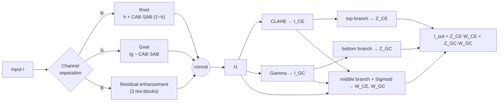

# Method

## 1. The colour prior (paper Fig. 1)

For each training pair the paper measures the mean of each channel in the ground truth minus its
mean in the underwater image. **Red** comes out consistently positive, meaning it is attenuated.
**Green** comes out negative, meaning it is over-strengthened. **Blue** stays near zero. On the UGAN
test set this implementation measures **R +45.3, G −22.1, B −20.7** (0–255 scale).

## 2. Attention-guided colour compensation (paper §3.1)

**Rnet**, Eq. (1): the red channel gets a gated compensation term.

\[
I_{rc} = I_r + \mathrm{CAB}(I_r)\cdot \mathrm{SAB}\cdot (1 - I_r)
\]

**Gnet**, Eq. (2): part of the over-strong green channel is subtracted.

\[
I_{ga} = I_g - \mathrm{CAB}(I_g)\cdot \mathrm{SAB}
\]

- **CAB** (channel attention): Global Average Pooling → FC → Sigmoid, squeeze-and-excitation style.
- **SAB** (spatial attention): two 3×3 convolutions → Sigmoid, giving an \(H\times W\times 1\) map.
- The **blue** channel is refined by three residual blocks (conv-LReLU-conv-LReLU-conv + skip).
- The three corrected channels are concatenated into \(I_1\).

## 3. Contrast enhancement: MSCNN + CLAHE + Gamma (paper §3.2)

\[
I_{CE} = \mathrm{CLAHE}(I_1),\qquad I_{GC} = I_1^{\gamma}
\]

- **Top and bottom branches** (3×3 → 5×5 → 7×7 convolutions) refine \(I_{CE}\) and \(I_{GC}\) into \(Z_{CE}\) and \(Z_{GC}\).
- **Middle branch** takes \([I_1, I_{CE}, I_{GC}]\) through 3×3, 5×5, 7×7, 1×1, 3×3, 5×5 and 7×7 convolutions, then a Sigmoid. The output is split in half to give the confidence maps \(W_{CE}\) and \(W_{GC}\).

\[
I_{out} = Z_{CE}\cdot W_{CE} + Z_{GC}\cdot W_{GC} \qquad (3)
\]

## 4. Loss (paper §3.3)

\[
\mathcal{L} = \lambda_1\,(\mathcal{L}_1 + \mathcal{L}_{SSIM}) + \lambda_2\,\mathcal{L}_{per},\qquad \lambda_1 = 1,\ \lambda_2 = 0.1
\]

- \(\mathcal{L}_{SSIM}\) is computed on grayscale images with an 11×11 Gaussian window.
- \(\mathcal{L}_{per}\) is the L1 distance between VGG-19 *relu4_3* features of the prediction and the ground truth.

## 5. Implementation choices where the paper is not explicit

| Detail | Choice | Reason |
|---|---|---|
| CAB on a 1-channel input | Lift the channel to 32 features with a 3×3 conv, apply CAB, then map back with a 3×3 conv | GAP→FC over a single channel has nothing to weigh |
| Placement of \((1-I_r)\) | Multiplies the *whole* compensation term | Matches Eq. 1; a saturated red channel is left unchanged, and the smoke test checks this |
| CLAHE | `kornia.enhance.equalize_clahe`, clip 2.0, 8×8 tiles, per RGB channel, no gradient, always fp32 | Behaves like OpenCV CLAHE |
| Gamma | \(\gamma = 0.7\) | The value Water-Net uses (Li et al., the UIEB paper) |
| SSIM constants | "c1 = 0.02, c2 = 0.03" read as \(K_1, K_2\), so \(C=(K\cdot L)^2\) | Taken literally, the constants would swamp SSIM on [0,1] images |
| Width | 32 channels everywhere: **317,697 parameters**, 1.3 MB | The paper stresses a light network |
| Precision | fp32 with TF32; fp16 is opt-in (`--amp`) | fp16 runs failed to converge; see [Reproduction notes](reproduction.md) |

The code is in [`uie/models`](api/models.md) and [`uie/losses.py`](api/losses.md).
